# BoopBox Server — Data Model Diagram

Entity-relationship diagram of the SQLite schema described in
[data_design.md](data_design.md) and defined in `server/app/db/tables.py`.

The actor columns (`created_by`, `updated_by`, `deleted_by`, `granted_by`,
`requested_by`) all reference `users.id` and are marked `FK`. Their lines are
left out to keep the diagram readable; a NULL actor means the server itself.

```mermaid
erDiagram
    users ||--o{ auth_identities : "logs in with"
    users ||--o{ invites : "is invited by"
    users |o--o{ auth_history : "attempted as"
    users ||--o{ user_permissions : "holds"
    permissions ||--o{ user_permissions : "granted as"
    users ||--o{ user_device_permissions : "holds"
    devices ||--o{ user_device_permissions : "scopes"
    permissions ||--o{ user_device_permissions : "granted as"

    mappings ||--o{ mapping_entries : "plays"
    media_sources ||--o{ mapping_entries : "serves"
    mappings ||--o{ mapping_devices : "limited to"
    devices ||--o{ mapping_devices : "listed in"
    mappings ||--o{ playback_progress : "tracks"
    devices ||--o{ playback_progress : "tracks"

    devices ||--o{ tags : "first saw"
    devices ||--o{ tags : "last saw"
    devices ||--o{ boops : "sent"
    tags |o--o{ boops : "read in"
    mappings |o--o{ boops : "resolved to"
    mapping_entries |o--o{ boops : "chosen in"
    media_sources |o--o{ boops : "played from"

    users |o--o{ backups : "requested"

    schema_info {
        INTEGER id PK "always 1"
        INTEGER version
        TEXT created_at
    }

    settings {
        TEXT key PK "registry key, a-z 0-9 . _"
        TEXT value "JSON, or ciphertext when encrypted"
        INTEGER encrypted "0 or 1"
        TEXT updated_at
        INTEGER updated_by FK
    }

    users {
        INTEGER id PK
        TEXT display_name "1-64"
        TEXT email "optional, never verified"
        INTEGER is_owner "unique when 1"
        INTEGER disabled
        INTEGER token_version "bumped to revoke tokens"
        TEXT last_login_at
        TEXT created_at
        INTEGER created_by FK
        TEXT updated_at
        INTEGER updated_by FK
        TEXT deleted_at "NULL means live"
        INTEGER deleted_by FK
    }

    auth_identities {
        INTEGER id PK
        INTEGER user_id FK "one live identity per user"
        TEXT provider "local, jellyfin, google"
        TEXT issuer
        TEXT subject "local username, reserved forever"
        TEXT label "display name from the provider"
        TEXT secret_hash "Argon2id, local only"
        INTEGER must_change_password
        INTEGER failed_attempts
        TEXT last_failed_at
        TEXT locked_until
        TEXT last_used_at
        TEXT created_at
        TEXT updated_at
        TEXT deleted_at
        INTEGER deleted_by FK
    }

    invites {
        INTEGER id PK
        INTEGER user_id FK
        TEXT code_hash UK "SHA-256"
        TEXT expires_at
        TEXT used_at
        TEXT created_at
        INTEGER created_by FK
        TEXT deleted_at "revoked"
        INTEGER deleted_by FK
    }

    auth_history {
        INTEGER id PK
        TEXT at
        TEXT outcome "success, bad_credentials, unknown_user, ..."
        TEXT provider
        TEXT issuer
        INTEGER user_id FK "NULL when no user matched"
        TEXT identifier "as typed, untrusted"
        TEXT client_ip
        TEXT user_agent
    }

    permissions {
        TEXT id PK "e.g. users.manage, seeded from code"
        TEXT scope "global, device, both"
        TEXT description
    }

    user_permissions {
        INTEGER user_id PK, FK
        TEXT permission_id PK, FK
        TEXT granted_at
        INTEGER granted_by FK
    }

    user_device_permissions {
        INTEGER user_id PK, FK
        TEXT device_id PK, FK
        TEXT permission_id PK, FK
        TEXT granted_at
        INTEGER granted_by FK
    }

    devices {
        TEXT id PK "MQTT topic id, a-z 0-9 _ -"
        TEXT friendly_name
        TEXT mqtt_account
        INTEGER revoked
        TEXT ota_secret_hash "SHA-256 hex"
        TEXT device_token_hash "SHA-256 hex"
        TEXT last_seen_at "telemetry"
        TEXT firmware_version "telemetry, up to 32"
        TEXT created_at
        INTEGER created_by FK
        TEXT updated_at
        INTEGER updated_by FK
        TEXT deleted_at
        INTEGER deleted_by FK
    }

    media_sources {
        INTEGER id PK
        TEXT type "jellyfin"
        TEXT name
        TEXT name_key "case-folded, unique among live"
        TEXT base_url "unique per type among live"
        TEXT settings "JSON object"
        TEXT secret_encrypted "v1 kid ciphertext"
        INTEGER enabled
        TEXT created_at
        INTEGER created_by FK
        TEXT updated_at
        INTEGER updated_by FK
        TEXT deleted_at
        INTEGER deleted_by FK
    }

    mappings {
        INTEGER id PK
        TEXT slug UK "lowercase, immutable"
        TEXT name "friendly, not unique"
        INTEGER all_devices "1 means every box"
        TEXT play_order "sequential, random"
        TEXT play_type "one, all, all_repeat"
        TEXT created_at
        INTEGER created_by FK
        TEXT updated_at
        INTEGER updated_by FK
    }

    mapping_devices {
        INTEGER mapping_id PK, FK
        TEXT device_id PK, FK
        TEXT created_at
        INTEGER created_by FK
    }

    mapping_entries {
        INTEGER id PK
        INTEGER mapping_id FK
        INTEGER source_id FK
        TEXT item "opaque id on the source"
        TEXT kind "item, collection"
        INTEGER position
        TEXT title "cached by the UI"
        TEXT status "unknown, ok, missing"
        TEXT status_checked_at
        TEXT created_at
        INTEGER created_by FK
        TEXT updated_at
        INTEGER updated_by FK
        TEXT deleted_at
        INTEGER deleted_by FK
    }

    playback_progress {
        INTEGER mapping_id PK, FK
        TEXT device_id PK, FK
        TEXT queue "JSON list of source and item"
        INTEGER position
        TEXT created_at
        TEXT last_played_at "expiry is measured from here"
    }

    tags {
        INTEGER id PK
        TEXT uid UK "uppercase hex with colons"
        TEXT first_seen_at
        TEXT first_seen_device_id FK
        TEXT first_slug "as read, may be empty"
        TEXT last_seen_at
        TEXT last_seen_device_id FK
        TEXT last_slug
    }

    boops {
        INTEGER id PK
        TEXT received_at "server clock"
        TEXT device_id FK
        INTEGER tag_id FK
        TEXT slug "as read"
        TEXT box_at "box clock, informational"
        TEXT correlation_id
        TEXT outcome "played, unknown_tag, out_of_scope, ..."
        INTEGER mapping_id FK "SET NULL on mapping delete"
        INTEGER entry_id FK "SET NULL on mapping delete"
        INTEGER source_id FK
        TEXT item
    }

    backups {
        INTEGER id PK
        TEXT started_at
        TEXT finished_at
        TEXT status "running, succeeded, failed"
        TEXT origin "scheduled, manual"
        INTEGER requested_by FK
        TEXT path
        INTEGER size_bytes
        TEXT error
    }
```

