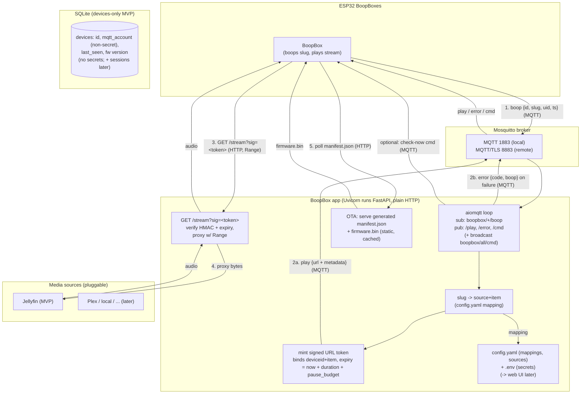

# BoopBox Server — Design

Planning doc. No implementation yet.

## Table of contents

- [Scope](#scope)
- [Stack](#stack)
- [Transport / TLS](#transport--tls)
- [MQTT topics](#mqtt-topics)
  - [TLS, ACLs, and what actually protects what](#tls-acls-and-what-actually-protects-what)
- [Tag model](#tag-model)
- [Stream URL security — signed URL](#stream-url-security--signed-url)
  - [Token construction](#token-construction)
  - [Per-device secrets](#per-device-secrets)
- [Streaming — proxy model](#streaming--proxy-model)
  - [Token TTL and pause/resume](#token-ttl-and-pauseresume)
- [Protocol versioning (`v`)](#protocol-versioning-v)
- [Boop payload](#boop-payload)
- [Error handling](#error-handling)
  - [MQTT errors](#mqtt-errors)
  - [HTTP errors](#http-errors)
  - [LED behavior (MVP vs later)](#led-behavior-mvp-vs-later)
- [Play command payload](#play-command-payload)
- [OTA firmware updates](#ota-firmware-updates)
  - [Static file layout](#static-file-layout)
  - [Manifest shape](#manifest-shape)
  - [Manifest generation (server-generated, cached)](#manifest-generation-server-generated-cached)
  - [Check-now nudge](#check-now-nudge)
  - [Out of scope for MVP](#out-of-scope-for-mvp)
- [Deployment — Docker, and bundled vs external broker](#deployment--docker-and-bundled-vs-external-broker)
- [Config and auth](#config-and-auth)
  - [`config.yaml` sketch](#configyaml-sketch)
  - [`.env` sketch](#env-sketch)
- [Media source abstraction](#media-source-abstraction)
- [SQLite schema](#sqlite-schema)
  - [Connection pragmas — WAL](#connection-pragmas--wal)
- [Open questions](#open-questions)
- [Architecture diagram](#architecture-diagram)

## Scope

A Python server that bridges the BoopBox fleet to media sources:

- Acts as an MQTT client of a Mosquitto broker (control channel).
- Serves audio over plain HTTP by proxying from media sources (Jellyfin first).
- Resolves tag slugs to media via a SQLite mapping editable from a parent web UI.
- Pushes OTA firmware updates to boxes.

Local-first. Remote is possible but TLS/exposure is the admin's responsibility
(see Transport).

## Stack

| Role | Choice | Notes |
|------|--------|-------|
| MQTT broker | Eclipse Mosquitto | Separate process/service. Owns MQTT TLS (8883) + ACLs. Not embedded in the app. Bundled or external (see Deployment). |
| MQTT client | aiomqtt | Single asyncio loop alongside HTTP. |
| HTTP + web UI | FastAPI | Audio streaming + parent-facing API. |
| ASGI server | Uvicorn | Runs FastAPI, owns the socket. Plain HTTP only. |
| Datastore | SQLite | MVP. Abstracted so other DBs can be added later. |
| Media sources | pluggable interface | Jellyfin is the first implementation. |

## Transport / TLS

The app speaks **plain HTTP** and does not terminate TLS. If an admin wants
remote access with HTTPS, they place their own reverse proxy or tunnel in front.
This keeps the app's job narrow and makes local-first the default.

Consequences:
- `public_base_url` is **admin-supplied config** — the URL a box should use to
  reach the server through whatever the admin's network/proxy provides. The app
  does not derive its scheme/host from its own socket.
- Mosquitto owns the MQTT TLS surface (8883 remote, 1883 local). The broker does
  not serve HTTP/audio.
- Two independent surfaces: MQTT (broker) and audio HTTP (app). No single
  component unifies them; that's the admin's proxy if they want one.

## MQTT topics

- Box publishes boops to `boopbox/<deviceid>/boop`.
- Server publishes play commands to `boopbox/<deviceid>/play`.
- Server publishes other commands to `boopbox/<deviceid|all>/cmd` (incl. OTA signal).

Per-device broker credentials; a lost box can be revoked without reflashing the
fleet (see initial_notes.md). This is the box's only per-device secret — the HTTP
stream is protected by a signed URL, not a credential (see Stream URL security).

### TLS, ACLs, and what actually protects what

MQTT TLS does **not** hide payloads from other clients on the same broker. TLS
encrypts each client<->broker link against network eavesdroppers; the broker
still decrypts every message and re-delivers it to subscribers. Confidentiality
and integrity *between clients* come from **broker authorization (ACLs)**, not
TLS.

What each layer actually protects:

- **TLS** — nobody on the network can read the traffic.
- **Signed stream URL** (app-enforced) — protects the **audio plane**. The URL is
  a bearer capability bounded by its HMAC signature and expiry (see Stream URL
  security); it does *not* depend on ACLs. Note the honest limit: a leaked play
  command *does* yield a usable URL until it expires.
- **Per-device ACLs** (broker config) — protect the **control plane**. Their key
  job is the *publish* side: without ACLs, any authenticated client can publish
  to any topic, so a single compromised/leaked broker credential can inject
  commands to other devices (incl. the OTA/`cmd` channel), spoof boops, or flood
  the fleet. ACLs also provide minor metadata privacy on the subscribe side
  (who can see what's playing).

ACLs live **entirely in the broker** (e.g. Mosquitto pattern `boopbox/%u/#`), not
in this app. The app is only ever a client.

**Broadcast topic exception.** The OTA check-now broadcast (`boopbox/all/cmd`)
falls outside each box's own `boopbox/<id>/#` subtree, so the per-device pattern
must be extended: a box may **subscribe** to `boopbox/all/cmd` (read-only), and
only the **server** account may **publish** there. Without this explicit rule the
per-device ACL would (correctly) block boxes from receiving broadcasts.

## Tag model

- The tag carries an opaque **slug** (NDEF text record, e.g. `boop/zelda`).
- SQLite maps `slug -> source + item`. The box never knows what Jellyfin is.
- Slugs are human-readable and portable across boxes; the parent web UI edits the
  mapping.

## Stream URL security — signed URL

**Constraint that drives this design:** the ESPHome media player plays a *URL* and
cannot attach custom HTTP headers (no `Authorization`/bearer). So the box cannot
present a separate credential on the stream request — everything must ride in the
URL. We follow the Home Assistant pattern of a **signed query parameter**.

What protects the stream, then:
- **HMAC signature** — the URL cannot be forged or altered (change the item, the
  expiry, anything, and the signature fails).
- **Expiry** — bounds the replay window (duration-aware; see Token TTL).
- **Transport** — the URL only travels over the box's already-authenticated MQTT
  channel (the play command) and the HTTP fetch; remote hops rely on TLS.

#### Token construction

The URL carries **one opaque, self-contained token** in the `sig` query param and
nothing else — no bound fields in the clear. The token is the only thing the box
holds and the only thing it plays; it does not parse it. The server is the only
party that reads the bound values back out, so they live *inside* the token:

```
claims  = { device, source, item, exp }      # exp is unix seconds (server clock)
body    = base64url(json(claims))             # or any compact deterministic encoding
mac     = HMAC-SHA256(stream_secret, body)    # BOOPBOX_STREAM_SECRET from .env
token   = body + "." + base64url(mac)         # the opaque <token> in ?sig=<token>
```

Verification on `GET /stream?sig=<token>` is the exact inverse, in this order:

1. Split on `.` into `body` and `mac`. Missing part, wrong shape, or bad base64 =
   **malformed** → `unauthorized`/401 (see HTTP errors). The server does not look
   at the claims yet.
2. Recompute `HMAC-SHA256(stream_secret, body)` and compare to `mac` in **constant
   time**. Mismatch = **invalid** → `forbidden`/403.
3. Only after the MAC verifies, decode `body` and read the claims. Check `exp`
   against the **server clock** (not any box-supplied time). Expired = `forbidden`/403.
4. Use `source + item` to open the upstream stream; `device` is recorded for
   provenance only (see below).

Flow:
1. Box boops a slug over MQTT.
2. Server resolves slug -> source + item via the config mapping.
3. Server mints an HMAC-signed token binding `deviceid + source + item + expiry`,
   where `expiry = now + item_duration + pause_budget` (see Token TTL and
   pause/resume).
4. Server mints the opaque token (see Token construction) and publishes the play
   command (stream URL `?sig=<token>` + metadata) to the box.
5. Box fetches `GET /stream?sig=<token>`. Server verifies the signature and
   expiry, then proxies bytes (honoring `Range`).

Role of `deviceid`: it is **provenance/audit**, not an enforced access control.
The server cannot verify the *requester* is that device (no out-of-band proof is
possible), so `deviceid` records which box the URL was minted for and leaves the
door open to real device binding later if firmware ever gains a credential
channel — re-addable without a protocol change since the field is already there.

### Per-device secrets

There is **one** per-device secret: the **MQTT credential** (broker-dependent). It
authenticates the box to the broker and is ACL-scoped to its own `boopbox/<id>/#`
topics on an ACL broker; it is optional on a no-ACL external broker, where a
shared login may be used instead (see ACLs: bundled vs external broker). Revocable
per-device without reflashing the fleet.

There is **no separate stream credential.** The earlier design had the box present
one on the HTTP stream request, but the ESPHome media player cannot send custom
headers (see Stream URL security), so there is nothing for the box to present. The
stream is protected by the signed URL instead.

The MQTT credential, when used, is owned by the broker (Mosquitto's own hashed
password store); the app does not store an MQTT hash. (Standing rule — default to
the safer industry practice — still applies to future UI user passwords, which
will use a slow hash such as **Argon2id**.)

## Streaming — proxy model

Box <- BoopBox app <- media source. The app relays the upstream byte stream and
forwards HTTP `Range` so the box can seek/resume. Jellyfin credentials and URLs
never leave the server. Costs bandwidth through the app; acceptable for the
local-first target. A redirect mode may be added later as a config toggle.

### Token TTL and pause/resume

A media player that pauses does not hold the TCP socket open; on resume it issues
a **new `GET` with a `Range` header** carrying the same stream URL. So **every
request re-validates the token** — "validate at stream start only" is not viable,
because a resume after a long pause is a fresh request against a possibly-expired
token.

That makes a fixed short TTL (120s) wrong for the target use case: a kid pausing a
20-minute story for several minutes would resume against an expired token.

**MVP: duration-aware stateless TTL.** The server knows the item duration (it's in
the play metadata), so it mints the token with:

```
expiry = now + item_duration + pause_budget   (pause_budget e.g. 30 min)
```

A 20-min story gets a ~50-min token. Bounded, no server-side session state. Since
the signed URL is a bearer capability (no separate credential — see Stream URL
security), **expiry is the primary bound** on a leaked URL; the HMAC keeps it from
being forged or extended. The generous window is the accepted tradeoff for
pause/resume working without sessions.

**One clock: the server's.** Both the `now` used to mint `exp` and the `exp` check
on every `GET` (see Token construction) read the **server** clock. The box clock is
never consulted for expiry — the box doesn't parse the token, and the boop's `ts`
(box SNTP time) is informational only (see Boop payload). So a box with a skewed or
unset clock cannot shorten or extend a token's life; expiry is entirely the
server's call, mint and verify on the same clock.

**No-duration fallback.** If a source can't report item duration (a future live
stream, or an item returned without duration), the token expiry falls back to
`now + streaming.pause_budget_seconds`, or `now + 5 min` if that isn't set
either.

Config: `streaming.pause_budget_seconds` (default 1800). See Config.

## Protocol versioning (`v`)

Every MQTT payload (`boop`, `play`, `error`, `cmd`) carries a `v` field. It is a
**single global protocol version**, not a per-message version — `v` names the
version of the whole MQTT contract, and all message types move to the new number
together when it bumps.

Rules:

- **Global, not per-type.** One number across every message. A box speaking
  protocol v1 understands v1 for *all* messages; it never has to track a matrix
  like "play is v2 but boop is v1". Firmware versioning will track the protocol
  version, so a single integer tells a box the full contract it was built for.
- **Bump only on a breaking change.** Adding an optional field a consumer can
  ignore is **not** a bump (consistent with the firmware-coupling rule — ignored
  fields are free). Bump only when a parser would break: renaming/removing a read
  field, or changing a field's type/meaning. Because additive changes are free,
  the version stays stable and a bump is a real signal.
- **Integer, monotonically increasing.** No semver on the wire; the box does a
  plain integer compare.

Unknown-version behavior (fail safe):

- **Box receives** a message with a higher `v` than it speaks: ignore it (never
  act on an unparseable contract); for a boop-triggered response it may show the
  generic error LED.
- **Server receives** a `boop` with an unknown `v`: reject it and publish an
  `error` with code `unsupported_version` so the box is not left waiting.

## Boop payload

The box publishes to `boopbox/<id>/boop` when a tag is read:

```json
{
  "v": 1,
  "id": "<per-boop id>",
  "slug": "boop/zelda",
  "uid": "04:A3:...",
  "ts": 1760000000
}
```

- `id` — a **boop** correlation id the box generates per boop. Unique per device
  (always paired with the device id from the topic), not global; a short
  monotonic counter since boot or a few random bytes is enough. The server echoes
  it in the matching `play`/`error`. Note: this id is specifically a *boop*
  concept — a future server-initiated play (UI says "play X on the kitchen box"
  with no tap) has no boop and thus no id to echo (see Play/Error).
- `slug` — the NDEF text payload read from the tag; drives resolution.
- `uid` — the tag's hardware UID (box has it for free). Informational: useful for
  a future "unknown tag — assign it?" flow, diagnostics, and detecting a slug on
  an unexpected tag.
- `ts` — the box's SNTP timestamp (unix seconds) for when the boop happened.
  Firmware gates boops on a valid network-synced clock: the box does not enable
  booping until SNTP has resolved, so `ts` is trustworthy by the time any boop is
  sent (no "unset clock early in boot" boop). The server **also** records its own
  receive time; the two serve different purposes, and `ts` is never used for token
  expiry — that is the server clock's job (see Token TTL).
- `v` — payload schema version.

## Error handling

Two surfaces (MQTT, HTTP) share one **error code vocabulary** so firmware maps a
single set of states to behavior regardless of which channel delivered the error:

- `unknown_tag` — booped slug has no mapping.
- `item_unavailable` — mapping exists but the source cannot find/serve the item.
- `source_unavailable` — the source backend is down/unreachable (e.g. Jellyfin
  offline).
- `unsupported_version` — a `boop` arrived with a protocol `v` the server does not
  speak (MQTT only; see Protocol versioning).
- `unauthorized` — the token cannot even be **parsed**: `sig` missing, or
  malformed so verification can't run (HTTP only). See the boundary below.
- `forbidden` — the token **parses** but fails a check: bad HMAC or expired (HTTP
  only). See the boundary below.

**`code` is the contract; `message` is diagnostic-only.** Consumers branch on
`code` and nothing else. `message` is a free-text, human-readable hint for logs and
the future UI — never parsed, never branched on, and treated as **untrusted
display text** wherever it lands:

- **Don't leak source internals.** Errors bubbling up from a source (Jellyfin and
  friends) must be mapped to the vocabulary `code` and a *generic* `message`;
  never pass the upstream's raw error text, URLs, item ids, API keys, or stack
  through to the box or any client. Example: a Jellyfin 401/404 becomes
  `source_unavailable` / `item_unavailable` with a plain message, not the
  upstream body.
- **Treat `message` as inert text, never executable.** It may echo attacker-ish
  input (e.g. a booped slug, as in the `unknown_tag` example), so whatever renders
  it must escape/encode for its context — no interpolating it into HTML, a shell,
  SQL, a log-injection-prone sink, or an LED-config lookup. The granular `code`
  exists precisely so nothing downstream needs to read `message` to decide
  behavior.

### MQTT errors

Published to a dedicated `boopbox/<id>/error` topic (kept off `play` so the box's
handlers stay clean). Echoes the triggering boop so the box can match the error to
the boop it is waiting on:

```json
{
  "v": 1,
  "boop": { "id": "<correlation-id>", "slug": "boop/zelda" },
  "code": "unknown_tag",
  "message": "no mapping for slug 'boop/zelda'"
}
```

The box satisfies each boop with exactly one response — either a `play` command or
an `error` — both carrying the same `boop` correlation block. (An error always
stems from a boop, so its `boop` block is always present; only a server-initiated
`play` can omit it.)

Exception: an `unsupported_version` error may carry a **partial** `boop` block
(only the fields the server could parse before hitting the unknown `v`), or none
if the payload was unparseable. The box should treat the `boop` block as
best-effort for this code.

### HTTP errors

Consistent JSON body with the matching status line:

```json
{ "code": "forbidden", "message": "stream token expired" }
```

Status mapping: `unauthorized` -> 401, `forbidden` -> 403, `item_unavailable` ->
404, `source_unavailable` -> 502.

**401 vs 403 boundary.** The dividing line is *whether the token could be
evaluated at all*, matching the verification order in Token construction:

- **`unauthorized` / 401 — can't evaluate.** The token is missing or structurally
  broken, so the server never reaches the HMAC check: no `sig` param, no `.`
  separator, bad base64, or the `body`/`mac` halves don't split. **A truncated
  token is malformed, hence 401** — it's a broken token, not a wrong one.
- **`forbidden` / 403 — evaluated, rejected.** The token is well-formed and the
  server ran the full check, but it failed on the merits: the HMAC did not verify
  (forged/altered/wrong secret) or it verified but `exp` is past (expired).

Rule of thumb: a parse/shape failure is 401; a *verification* failure (signature
or expiry) is 403. The server stops at the first failure, so a malformed token is
reported as 401 even though it would also have failed the HMAC check.

### LED behavior (MVP vs later)

For MVP the box collapses all error codes to a single state (e.g. red LEDs). A
**support-later** item: let the server supply LED config (color/pattern) in error
and command responses so different situations can drive distinct light behavior
without a firmware change. The granular code set above is designed to make that
future mapping possible.

## Play command payload

Published to `boopbox/<id>/play` as JSON:

```json
{
  "v": 1,
  "boop": { "id": "<correlation-id>", "slug": "boop/zelda" },
  "url": "http://server/stream?sig=<token>",
  "title": "Song Title",
  "duration": 184,
  "album": "Album Title",
  "artist": "Artist Name"
}
```

- `boop` — echoes the triggering boop (`id` + `slug`) so the box can match this
  command to the boop it is waiting on. **Present only when a boop caused this
  play.** A future server-initiated play (no tap) omits it; the box then treats it
  as an unsolicited command rather than a boop response.
- `url` — the only field the box must act on (feeds the media player). It carries a
  single opaque token in the `sig` query param (never a path segment, consistent
  with the signed-query-param design — see Stream URL security). The box treats the
  whole URL as opaque and just plays it; all bound values live inside the token.
- `title`, `duration` (whole seconds), `album`, `artist` — display/now-playing
  metadata; the box may ignore them until it has a consumer (screen, HA report).
- `v` — payload schema version; lets firmware branch instead of break if the
  structure ever changes. Fields are hardcoded in the app, not configurable.

## OTA firmware updates

Decided: use ESPHome's **managed updates** platform (`update: http_request`),
which is the lowest-effort path for the server.

- The box firmware gains `http_request:`, `ota: http_request`, and
  `update: http_request` with `source:` pointing at a manifest URL on this
  server. (Firmware change — out of scope for the server work, noted here for
  alignment.)
- The server's OTA job reduces to **hosting static files**: a `manifest.json`
  (ESP-Web-Tools format with an `ota` block: `md5`, `path`, `version`,
  `chipFamily`) and the `firmware.bin` per build. The existing HTTP file server
  already does this; no push protocol or per-device coordination needed.
- The box pulls on its own `update_interval` (default 6h), compares versions via
  the manifest, and installs on its own or on command.

### Static file layout

Laid out per-chip so the manifest's multi-build support stays future-proof even
though MVP is one board (ESP32-S3). Firmware URLs use absolute paths (leading `/`)
so they resolve against `source:` with no redirects.

```
/firmware/manifest.json              # served; generated by the app (see below)
/firmware/esp32s3/boopbox-0.2.0.bin
/firmware/esp32s3/boopbox-0.1.0.bin  # kept for rollback
```

### Manifest shape

ESP-Web-Tools format with the ESPHome `ota` extension:

```json
{
  "name": "BoopBox",
  "version": "0.2.0",
  "builds": [
    {
      "chipFamily": "ESP32-S3",
      "ota": {
        "md5": "<md5 of the bin, computed from disk>",
        "path": "/firmware/esp32s3/boopbox-0.2.0.bin",
        "summary": "What changed",
        "release_url": ""
      }
    }
  ]
}
```

### Manifest generation (server-generated, cached)

The server **generates** `manifest.json` rather than the admin hand-writing it.
Rationale: the `md5` is a correctness-critical field (the box rejects an update
whose md5 doesn't match, so a hand-typed md5 breaks OTA fleet-wide and fails
silently). Generating it removes that whole class of error and keeps a single
version source of truth.

- Admin's only job to publish a build: **place the bin** in the chip dir and set
  `ota.manifest_version` in `config.yaml`.
- The server computes the `md5` **from the bytes on disk** (never typed), fills
  the ESP-Web-Tools template, and emits one `builds` entry per chip subfolder that
  has a bin at the configured version.
- `config.yaml` is the single source of truth for `version`.

Caching: the manifest is built **at startup and on config reload**, cached, and
recomputed if a bin's mtime changes — so the fleet's 6h polls don't recompute md5
every request, while staying consistent with disk.

### Check-now nudge

Publish a command envelope to make a box check the manifest immediately instead of
waiting for its interval. Both scopes supported for MVP:

- Per-device: `boopbox/<id>/cmd`
- Broadcast (whole fleet): `boopbox/all/cmd`

```json
{ "v": 1, "cmd": "check_update" }
```

Broadcast causes the whole fleet to pull at once (thundering herd on the bin); fine
for a small fleet, noted as a scaling consideration.

### Out of scope for MVP

Staged / canary rollout. Managed updates are all-or-nothing: every box sees the
same manifest and updates on its interval. Canarying would need per-device
manifest URLs or version pinning — deferred.

Gotcha: the ESPHome HTTP Request component has a ~512-byte URL buffer, so
redirecting manifest URLs can fail ("Out of buffer"). Self-hosting the manifest
with direct (non-redirecting) paths avoids this.

Refs: https://esphome.io/components/update/http_request/ ,
https://esphome.io/components/ota/http_request/

## Deployment — Docker, and bundled vs external broker

Everything is orchestrated by Docker Compose. The **app is always only an MQTT
client**; it never starts a broker itself. "Use a custom broker vs our own" is a
deployment concern, not app logic:

- **App config** (file + env): how to *connect* to a broker —
  host/port/credentials/TLS. The app cares about nothing else.
- **Orchestration** (compose + env): whether the bundled Mosquitto service runs.

Mechanism: a Compose **profile** (e.g. `bundled-broker`) includes the mosquitto
service; leaving the profile out means no bundled broker runs. `BOOPBOX_MQTT_HOST`
(and friends) point the app at either the bundled service or the admin's external
broker. So "if a custom broker is present, don't start the local one" = the
admin's compose/env selects the profile and sets the host. No app-side detection
logic needed.

## Config and auth

Two files, split by nature of the data:

- **`config.yaml`** — structured, human-edited data model that becomes the UI
  later. No secrets. Holds: media sources (array), slug -> media mappings,
  streaming options, OTA settings.
- **`.env`** — secrets and deploy-specific values. Holds: stream signing secret,
  broker connection + the app's broker credential, source API keys,
  `public_base_url`, and (MVP only) a single seed test device.

**Device data lives in SQLite**, not in either file — it's dynamic fleet data the
future UI will manage. For MVP, one seed test device is read from `.env` at
startup and upserted into SQLite if absent. Everything else about devices (adding,
revoking, per-device secrets) is DB-backed from day one so the UI port is
additive, not a migration.

Defaults (all of these are optional in the environment):

- `BOOPBOX_PUBLIC_BASE_URL` -> `http://127.0.0.1:8000` (local-first loopback).
- MQTT connection -> `localhost:1883`, no auth, no TLS (bundled-broker local case).

Auth is deferred but planned: the future UI supports **local accounts or SSO**.
The config-file MVP has no UI auth; keep the data model UI- and auth-ready so the
port doesn't require reshaping it.

### `config.yaml` sketch

```yaml
# Structured, human-edited. No secrets. Becomes the UI later.
sources:                       # array: more than one source may be configured
  - id: jellyfin-main
    type: jellyfin
    base_url: http://jellyfin:8096
    user_id: ""                # optional
    # api key is injected from .env, referenced by source id

mappings:                      # slug -> source + item
  "boop/zelda":
    source: jellyfin-main      # references a source by id
    item: "a1b2c3d4e5f6..."    # opaque source-internal id (Jellyfin item id); admin/UI fills it in

streaming:
  mode: proxy                  # proxy | redirect (redirect later)
  pause_budget_seconds: 1800   # added to item duration for the token expiry
                               # (duration-aware TTL; see Token TTL and pause/resume)

ota:
  manifest_version: "0.1.0"    # drives the hosted manifest.json
```

### `.env` sketch

```dotenv
# Secrets + deploy-specific. Not committed.
BOOPBOX_STREAM_SECRET=change-me

# Optional; defaults shown. Omit for the local bundled-broker case.
BOOPBOX_MQTT_HOST=localhost
BOOPBOX_MQTT_PORT=1883
BOOPBOX_MQTT_USERNAME=
BOOPBOX_MQTT_PASSWORD=
BOOPBOX_MQTT_TLS=false
BOOPBOX_MQTT_TLS_CA=

# Optional; defaults to loopback for local-first.
BOOPBOX_PUBLIC_BASE_URL=http://127.0.0.1:8000

# Per-source secret, keyed by source id.
BOOPBOX_SOURCE_JELLYFIN_MAIN_API_KEY=

# MVP only: one seed test device, upserted into SQLite at startup.
BOOPBOX_SEED_DEVICE_ID=boop-test
BOOPBOX_SEED_DEVICE_MQTT_PASSWORD=
```

## Media source abstraction

The server only talks to a source interface, never to Jellyfin directly. A source
can: take the mapping's opaque `item` id and open a byte stream for it, honoring a
Range header. Slug resolution (slug -> source + item) happens in the app via the
config/DB mapping, *before* the source is involved — the source never sees the
slug and the tag never carries a source scheme. Jellyfin is the MVP
implementation; Plex, local files, etc. come later.

## SQLite schema

Devices-only for MVP. Mappings stay in `config.yaml`. Soft-delete via `revoked`
so a device id can't be silently reused and we keep an audit trail.

```sql
CREATE TABLE devices (
    id                 TEXT PRIMARY KEY,         -- e.g. "boop-kitchen"
    friendly_name      TEXT,
    mqtt_account       TEXT,                     -- non-secret pointer to broker account; NULL on shared-login brokers
    revoked            INTEGER NOT NULL DEFAULT 0,
    last_seen_at       TEXT,                     -- ISO-8601 UTC; populated from boop/OTA traffic
    firmware_version   TEXT,                     -- reported by the box; for OTA visibility
    created_at         TEXT NOT NULL,
    updated_at         TEXT NOT NULL
);
```

Design notes:
- No stream-credential columns — the stream is protected by a signed URL, not a
  per-device credential (see Stream URL security), so there is nothing to store.
- No `mqtt_password_hash` — the broker owns MQTT auth. `mqtt_account` is just a
  non-secret reference, NULL when a shared broker login is used.
- `last_seen_at` / `firmware_version` are cheap to populate now and useful for the
  future UI and OTA status.
- The table currently holds no secrets at all; it is non-secret device metadata.
  This is deliberate, and it's why the two potential secrets live elsewhere: the
  **MQTT credential** is owned by the broker (Mosquitto's hashed password store —
  see Per-device secrets), and the **stream** has no credential at all (signed URL,
  not a stored token — see Stream URL security). So the only columns that could
  reference auth (`mqtt_account`) are non-secret pointers, not the secrets
  themselves. A dumped `devices.db` leaks fleet metadata (ids, names, firmware
  versions, last-seen) but **no credential** — nothing in it can authenticate to
  the broker or fetch a stream. The future `sessions` table (post-MVP) is the first
  thing that would hold live, security-relevant rows; it's called out separately so
  this "no secrets here" property is a conscious MVP stance, not an accident.

### Connection pragmas — WAL

Run in **WAL** (Write-Ahead Logging) mode: the async HTTP server and the MQTT loop
both touch the DB concurrently (e.g. a boop updating `last_seen_at` while an HTTP
request reads a device row), and WAL lets readers and a writer proceed
concurrently instead of locking the whole file per write. Standard choice for a
SQLite-backed service.

Set on every startup connection (journal_mode is persistent, but setting it is
idempotent; the others are per-connection):

```sql
PRAGMA journal_mode = WAL;      -- concurrent reader + writer
PRAGMA synchronous  = NORMAL;   -- documented safe pairing with WAL; durable across
                                -- app crashes, far faster than FULL
PRAGMA foreign_keys = ON;       -- SQLite defaults this OFF per connection
PRAGMA busy_timeout = 5000;     -- WAL still serializes multiple writers; wait, don't
                                -- immediately SQLITE_BUSY
```

**Keep the DB off the event loop.** The app runs the MQTT loop and the HTTP server
on a **single asyncio loop** (see Stack). SQLite's driver is synchronous and
blocking, and `busy_timeout = 5000` means a contended write can *block its caller
for up to 5s*. If that call runs directly on the event loop, it freezes the whole
app for that window — in-flight audio proxying, every other HTTP request, and the
MQTT loop all stall, not just the one query. So every DB call must run **off** the
loop: either `asyncio.to_thread` / `run_in_executor` around the sync driver, or an
async wrapper such as `aiosqlite` (which runs each connection on its own thread).
The pragmas above are set per worker connection, not on the loop thread. The
busy-timeout wait is then absorbed by a worker thread, which is the behavior we
want — callers `await`, the loop stays live.

Deployment caveat: WAL needs a filesystem with proper locking/shared-memory
support. A local Docker volume is fine; **networked filesystems (NFS/SMB) can make
WAL unreliable** — keep the DB file on a local volume, not a network share.

## Open questions

- `.env` -> source API key naming convention (sketch uses
  `BOOPBOX_SOURCE_<ID>_API_KEY`; confirm when sources grow).

## Architecture diagram


