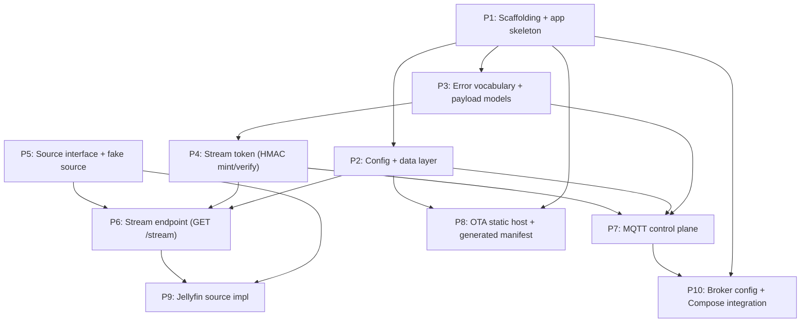

# BoopBox Server — Piece Breakdown

Coarse, independently-implementable pieces for the MVP server described in
`server_design.md`. Each piece is loosely coupled with a defined contract, is
testable against stubs before its real dependencies land, and ships as a
reviewable increment. Ordered so the progression makes sense. MVP only; items
marked later/post-MVP in the design doc are out of scope here.

## Dependency order

## Documentation rule (applies to every piece)

Docs and comments describe what exists and how to operate it — never why it was
chosen, never session or design-history context. README config and
development-guide entries, code, and comments read as standalone operational
reference. Rationale and tradeoffs live only in `notes/`. Config examples use
placeholders, never real secrets; the config reference shows which values are
secrets (`.env`) versus structured config (`config.yaml`).

If a piece introduces or changes an admin-relevant knob — a `config.yaml` key, a
`.env` variable, a default, a runtime requirement, or a run/test/lint command —
it updates the relevant README section in the same piece.

## Pieces

### P1 — Project scaffolding & app skeleton
**Objective:** A runnable, empty-but-wired Python project. `pyproject.toml` with
pinned deps (fastapi, uvicorn, aiomqtt, aiosqlite, pydantic, httpx, pytest).
Dockerfile + docker-compose.yml (app service only for now). FastAPI app factory +
Uvicorn entrypoint on a single asyncio loop, with a startup/shutdown lifecycle
hook that will later own the MQTT loop. A trivial `GET /health`. Project layout
(`app/`, `tests/`), linter/formatter config, `.gitignore` additions. Seed the
README with an operational project intro and a Development Guide (prerequisites,
install deps, run locally bare and via `docker compose up`, run tests, run
lint/format) plus the config-reference scaffold documenting only what exists so
far.
**Contract:** app factory, lifespan hook, settings entrypoint location.
**Test:** `GET /health` returns 200; app boots under Uvicorn in the container;
every command in the Development Guide is verified to work.
**Demo:** `docker compose up` serves `/health`; a new contributor can follow the
Development Guide top to bottom to a running server, passing tests, clean lint.

### P2 — Config + data layer
**Objective:** Load and validate `config.yaml` (sources array, slug→source+item
mappings, streaming options, ota settings) and `.env` (stream secret, broker
connection + app credential, per-source API keys, `public_base_url`, seed device)
into typed settings with documented defaults. SQLite `devices` schema created on
startup; `journal_mode=WAL`, `synchronous=NORMAL`, `foreign_keys=ON`,
`busy_timeout=5000` per connection; all DB access off the event loop
(aiosqlite / thread executor). Seed-device upsert at startup. A slug→(source,
item) resolver over the config mapping returning `unknown_tag` when absent.
Document the full `config.yaml` schema and `.env` reference with defaults.
**Contract:** `Settings`, device repository (get/upsert/update
last_seen+firmware), resolver function.
**Test:** config/env parse with defaults and overrides; invalid config rejected;
schema + pragmas applied; seed upsert idempotent; resolver hit/miss; DB call runs
off-loop.
**Demo:** boot with sample config/env; show the seed device in `devices.db` and a
resolver lookup returning source+item for a known slug and `unknown_tag` for an
unknown one.

### P3 — Error vocabulary, protocol versioning & payload models
**Objective:** Shared error-code enum (`unknown_tag`, `item_unavailable`,
`source_unavailable`, `unsupported_version`, `unauthorized`, `forbidden`), HTTP
status mapping (401/403/404/502), the `v` protocol-version constant with
unknown-version handling. Pydantic models for boop, play, error, cmd payloads,
each carrying `v` and the `boop` correlation block where applicable. A helper that
builds error responses with a generic, inert `message` that never leaks source
internals.
**Contract:** the models, error-code enum, HTTP-status map, error builder.
**Test:** models round-trip the documented JSON; error builder produces generic
messages; status mapping correct; unknown-`v` helper behaves.
**Demo:** serialize a sample boop/play/error to JSON matching the design doc;
show an error object with a scrubbed message.

### P4 — Stream token (pure HMAC mint + verify)
**Objective:** Dependency-free module that mints the opaque `body.mac` token from
claims `{device, source, item, exp}` and verifies it in order (split →
constant-time HMAC compare → decode → `exp` vs server clock). Duration-aware
expiry: `now + item_duration + pause_budget`, with the no-duration fallback
(`pause_budget`, then 5 min). Verification maps failures to `unauthorized`
(malformed/unparseable) vs `forbidden` (bad HMAC or expired).
**Contract:** `mint(claims, duration, now) -> token`,
`verify(token, now) -> claims | error`.
**Test:** round-trip; tampered body/mac → forbidden; truncated/malformed →
unauthorized; expired → forbidden; constant-time compare; duration + fallbacks
produce correct `exp`; server-clock-only.
**Demo:** mint a token for a 20-min item, show its ~50-min expiry, then verify
accepts it and rejects a tampered/expired variant with the right code.

### P5 — Media source interface + fake source
**Objective:** Define the source protocol: given an opaque `item` id, open an
upstream byte stream honoring a `Range` header and report item
metadata/duration where available. A fake in-memory source (fixed bytes, Range
support, can simulate `item_unavailable` / `source_unavailable`) for downstream
tests. Source registry keyed by source id from config.
**Contract:** the `Source` protocol, registry/lookup by id, the fake impl.
**Test:** fake streams full and ranged reads; reports duration; surfaces
unavailable conditions mapped to the vocabulary; registry resolves by id.
**Demo:** open a stream from the fake source, read a byte range, read its
reported duration.

### P6 — Stream endpoint (GET /stream, proxy + Range)
**Objective:** `GET /stream?sig=<token>` verifies the token (P4), opens the bound
source+item via the registry (P5), and proxies bytes honoring `Range`. Maps every
failure to the HTTP error contract (P3): malformed → 401, bad/expired → 403,
missing item → 404, source down → 502. Records `device` for provenance only.
**Contract:** the `/stream` route; proxy/Range behavior.
**Test:** valid token streams bytes and forwards Range; 401 malformed, 403
tampered/expired, 404 missing item, 502 source down; upstream errors scrubbed.
**Demo:** mint a token against the fake source, hit `/stream`, play/seek the
bytes, show each error status with the correct code.

### P7 — MQTT control plane (aiomqtt loop)
**Objective:** aiomqtt client on the app's single loop, started/stopped by the P1
lifecycle. Subscribes `boopbox/+/boop`; per boop: version-check
(`unsupported_version` on unknown `v`), resolve slug (P2), mint token (P4), build
the stream URL from `public_base_url`, publish `play` (with `boop` correlation
block + metadata) or `error` to `boopbox/<id>/{play,error}`. One response per
boop. Publishes `cmd` (incl. check-now) to `boopbox/<id>/cmd` and
`boopbox/all/cmd`. Updates `last_seen_at` off-loop. Connection config from P2 with
documented defaults. Document the `BOOPBOX_MQTT_*` vars and defaults.
**Contract:** the MQTT service (start/stop), publish helpers.
**Test (broker fixture or mocked client):** boop→play happy path with correct
correlation; unknown slug → `error unknown_tag`; unknown `v` →
`unsupported_version` (possibly partial boop block); exactly one response per
boop; URL uses `public_base_url`; last_seen updated off-loop.
**Demo:** publish a boop to a local broker, observe the `play` command with a
working signed URL (served by P6); publish an unknown slug, observe the `error`.

### P8 — OTA static host + generated manifest
**Objective:** Serve `/firmware/...` static files and a generated, cached
`/firmware/manifest.json` in ESP-Web-Tools format with the ESPHome `ota` block
(md5 computed from the bin bytes on disk, path, version, chipFamily). Built at
startup and on config reload, cached, recomputed when a bin's mtime changes.
Version from `ota.manifest_version`; one `builds` entry per chip subfolder holding
a bin at that version. Absolute (non-redirecting) firmware paths. Document
`ota.manifest_version` and the firmware directory layout.
**Contract:** the `/firmware` static mount + the manifest generator/cache.
**Test:** manifest md5 matches on-disk bytes; version from config; per-chip builds
entries; cache invalidates on mtime change; firmware served with Range.
**Demo:** drop a `boopbox-0.1.0.bin` in the chip dir, set the version, fetch a
correct `manifest.json` plus the bin.

### P9 — Jellyfin source implementation
**Objective:** A real `Source` (P5 interface) for Jellyfin: use config `base_url`
+ `.env` API key (keyed by source id) to open an item's audio byte stream honoring
Range, and report duration from Jellyfin item metadata. Map all upstream failures
(401/404/5xx, connection errors) to `item_unavailable` / `source_unavailable` with
generic, scrubbed messages — never leaking URLs, item ids, keys, or upstream
bodies. Document the Jellyfin config block and API-key env naming.
**Contract:** the Jellyfin source registered under its config id; no change to P6.
**Test (mocked Jellyfin / httpx transport):** streams and forwards Range; reports
duration; 401/404/5xx mapped to the right code with scrubbed messages.
**Demo:** swap the fake for Jellyfin in config and stream a real item end-to-end
through `/stream`.

### P10 — Broker config & Compose integration (Mosquitto + ACLs)
**Objective:** Deployment glue: a Mosquitto service behind a Compose
`bundled-broker` profile (profile out = no bundled broker), with a Mosquitto
config + ACL file implementing the per-device pattern (`boopbox/%u/#`) plus the
broadcast exception (boxes may subscribe `boopbox/all/cmd` read-only; only the
server account may publish there). Wire `BOOPBOX_MQTT_*` so the app (P7) points at
either the bundled service or an external broker. Document bundled-vs-external and
the local-vs-TLS ports; note that fuller fleet/production deployment docs are
deferred. ACLs live entirely in the broker, not the app.
**Contract:** the Compose profile, the Mosquitto config/ACL files, documented env
wiring.
**Test:** `docker compose --profile bundled-broker up` brings up broker + app; the
app connects; end-to-end boop→play→stream works through the bundled broker; ACL
denies cross-device publish and allows the broadcast subscribe.
**Demo:** full local stack up via the Compose profile; a boop through the real
broker yields a played stream; an ACL denial shown for a cross-device publish.
