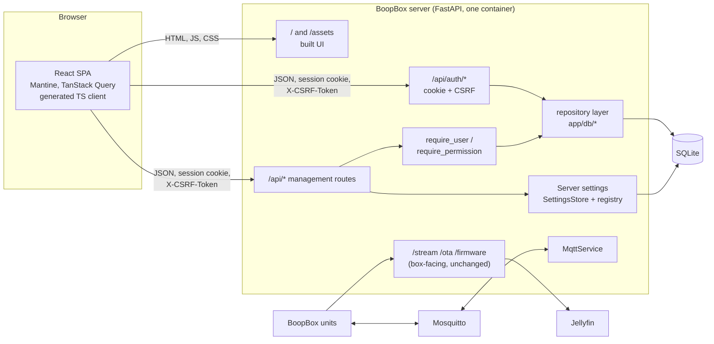
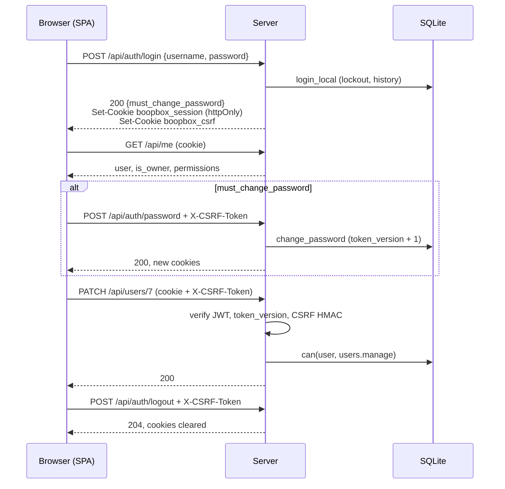
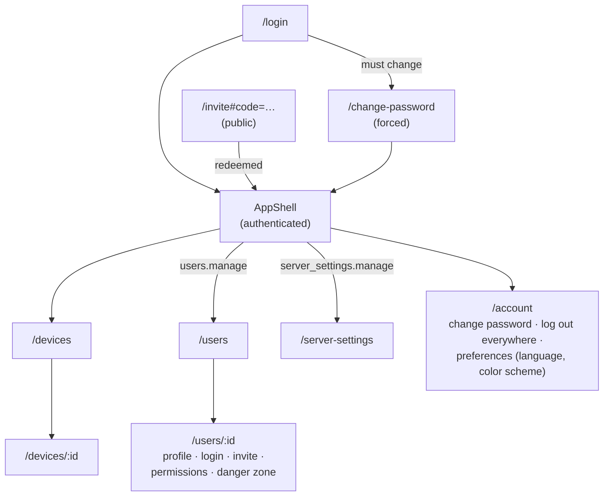

# BoopBox Server — UI Design

Planning doc for the web UI and the management API behind it. No
implementation yet. Builds on [data_design.md](data_design.md) and
[server_design.md](server_design.md). Items left out of this milestone are
tracked in [deferred.md](deferred.md).

## Table of contents

- [Scope](#scope)
- [Decisions](#decisions)
- [Terminology](#terminology)
- [Architecture](#architecture)
- [Repository layout](#repository-layout)
- [Serving and development](#serving-and-development)
  - [Production](#production)
  - [Development](#development)
  - [Security headers](#security-headers)
- [Authentication in the browser](#authentication-in-the-browser)
  - [Session cookie](#session-cookie)
  - [CSRF](#csrf)
  - [Forced password change](#forced-password-change)
  - [Auth sequence](#auth-sequence)
- [API conventions](#api-conventions)
  - [Route layout](#route-layout)
  - [Errors](#errors)
  - [Typed client](#typed-client)
- [Endpoints](#endpoints)
  - [Auth and session](#auth-and-session)
  - [Invites (public)](#invites-public)
  - [Users](#users)
  - [Permissions](#permissions)
  - [Devices](#devices)
  - [Server settings](#server-settings)
- [Screens](#screens)
  - [Screen map](#screen-map)
  - [Layout on phone and desktop](#layout-on-phone-and-desktop)
  - [Showing secrets once](#showing-secrets-once)
  - [Untrusted text](#untrusted-text)
- [Translation (i18n)](#translation-i18n)
- [Frontend structure](#frontend-structure)
- [Testing](#testing)
- [Implementation order](#implementation-order)
- [Open questions](#open-questions)

## Scope

First milestone: the admin foundation.

- Login, logout, forced password change, change own password, log out
  everywhere.
- Users: create, edit, disable, delete, invite, re-invite, revoke invites,
  clear a lockout.
- Invite redemption with a local username and password.
- Permissions: global and per-device grants.
- Devices: add, edit, revoke, delete, regenerate credentials.
- Server settings: edit, reset to default, show environment overrides.
  Includes setting `mqtt.password`.
- Translation: every UI string goes through i18n. English ships first.

Media sources, mappings, history screens, backups and everything else are
later milestones (see deferred.md).

The UI must work on both phones and desktops.

## Decisions

| Topic | Choice |
|-------|--------|
| Framework | React + Vite + TypeScript |
| Component library | Mantine (v9; needs React 19.2+) |
| Forms | `@mantine/form` |
| Router | React Router v7, declarative mode (routing only) |
| Data fetching | TanStack Query |
| API client | `openapi-fetch`, types generated by `openapi-typescript` from FastAPI's schema |
| Browser auth | httpOnly session cookie holding the existing JWT, plus a CSRF header |
| Location | `server/web/`, built into the server image and served by FastAPI |
| Human-facing API | everything under `/api`; existing `/auth/*` moves to `/api/auth/*` |
| Box-facing routes | unchanged: `/stream`, `/ota`, `/firmware`, `/health` |
| Invite login methods | local only |
| Frontend tests | Vitest + React Testing Library + MSW; no browser tests |
| Color scheme | Mantine `auto` (follows the OS light/dark setting) |
| Translation | `i18next` + `react-i18next`; English ships first |
| Server settings permission | new global `server_settings.manage` |
| Invite link root | `public_base_url`, the same root as the UI and API |

Dependency versions are pinned exactly in `package.json` when scaffolding, the
same way `pyproject.toml` pins Python packages. `package-lock.json` is
committed.

## Terminology

More than one kind of setting will exist, so each has its own name in code,
routes and UI text:

| Term | Meaning | Stored | Permission |
|------|---------|--------|------------|
| **Server settings** | the registry in `app/settings/registry.py`; the `settings` table in data_design.md | database, env overrides | `server_settings.manage` |
| **Preferences** | per-person UI choices: language, color scheme | browser (`localStorage`) for now | none; your own |
| **Device settings** | per-box configuration (later milestone) | not designed yet | not designed yet |

The bare word "settings" isn't used on its own in the UI, the API paths or the
permission names.

## Architecture



## Repository layout

```
server/
  app/
    routes/
      api/            # new: one module per resource (auth, users, devices, ...)
      web.py          # new: static assets + SPA fallback
  scripts/
    dump_openapi.py   # new: writes the OpenAPI schema and server setting keys
  web/                # new: the Vite project
    package.json
    vite.config.ts
    src/
      api/            # generated schema types, client, query hooks
      app/            # providers, router, AppShell
      features/       # auth, users, devices, server-settings, account
      components/     # shared UI (SecretReveal, ConfirmDanger, Timestamp, ...)
      i18n/           # i18next setup and typed-key declarations
      locales/
        en/           # one JSON file per namespace (common, users, ...)
      test/           # MSW handlers and test utilities
```

## Serving and development

### Production

- **Multi-stage Dockerfile.** A Node stage runs `npm ci && npm run build` in
  `web/`. The Python stage copies `web/dist` to `/app/web-dist`. Node is not in
  the final image.
- **`BOOPBOX_WEB_DIR`** points at the built assets. When it is unset or the
  directory is missing, the server runs API-only and logs that the UI is not
  served. Tests and API-only deployments use this.
- **Static assets.** `/assets/*` is served with
  `Cache-Control: public, max-age=31536000, immutable`, which is safe because
  Vite puts a content hash in every file name.
- **SPA fallback.** Any other `GET` that isn't a reserved prefix returns
  `index.html` with `Cache-Control: no-cache`, so a deploy is picked up on the
  next load. Reserved prefixes, which never fall back: `/api`, `/stream`,
  `/ota`, `/firmware`, `/health`, `/docs`, `/redoc`, `/openapi.json`. An unknown
  `/api/...` path returns a JSON 404, not HTML.
- **`.dockerignore`** excludes `web/node_modules` and `web/dist`.

### Development

- Run uvicorn on 9685 as today, and `npm run dev` in `server/web/` (Vite on
  5173).
- Vite proxies `/api` to `http://127.0.0.1:9685`. The browser only sees one
  origin, so cookies and CSRF behave the same as in production and the server
  needs no CORS setup.

### Security headers

Set on every UI response (`index.html` and assets):

- `Content-Security-Policy: default-src 'self'; style-src 'self' 'unsafe-inline';
  img-src 'self' data:; frame-ancestors 'none'; base-uri 'none'; form-action 'self'`.
  `'unsafe-inline'` for styles is needed because Mantine sets `style`
  attributes. Scripts stay `'self'` only.
- `X-Content-Type-Options: nosniff`
- `Referrer-Policy: no-referrer`

## Authentication in the browser

The server keeps one token format, the JWT from `app/auth/jwt.py`. The browser
holds it in a cookie; scripts keep using the bearer header.

### Session cookie

- **Name** `boopbox_session`. httpOnly, `SameSite=Strict`, `Path=/api`,
  `Max-Age` equal to `auth.token_lifetime_hours`.
- **`Secure`** is set when the request arrived over HTTPS. Behind a proxy the
  scheme comes from `X-Forwarded-Proto` only when `auth.trust_forwarded_header`
  is on, the same rule as `client_ip`. Plain-HTTP LAN access therefore works.
- **`require_user`** accepts either `Authorization: Bearer` or the cookie. If
  both are present, the header wins. Every existing check (signature, expiry,
  live user, `token_version`) is unchanged.
- **Expiry.** The token isn't refreshed. When it expires the API returns 401
  and the UI sends the person to the login page, then back to where they were.

### CSRF

Stateless double-submit, bound to the session:

- At login the server also sets `boopbox_csrf`, readable by JavaScript
  (`SameSite=Strict`, `Path=/`). Its value is
  `HMAC-SHA256(secrets.auth_token, "csrf:" + jwt)`, base64url.
- The client sends it back as `X-CSRF-Token` on every `POST`, `PUT`, `PATCH`
  and `DELETE`.
- The server recomputes the HMAC from the session cookie and compares in
  constant time. A missing or wrong header on a cookie-authenticated write is
  403 `forbidden`.
- **Bearer requests skip the check.** A browser never attaches an
  `Authorization` header on its own, so a bearer request can't be forged
  cross-site.
- Binding to the JWT means a new login, a password change or a logout produces
  a new CSRF value, and an old one stops working with its session.
- Login and invite redemption have no session yet. They are protected by
  `SameSite=Strict`, by requiring `Content-Type: application/json` (which a
  plain cross-site form can't send), and by checking `Origin` against the
  request's host when the header is present.

### Forced password change

- `require_user` already rejects a user with `must_change_password`. Only
  `/api/auth/password`, `/api/auth/logout` and `/api/me` admit them, through
  `require_user_allow_password_change`.
- `/api/me` reports `must_change_password`. The UI route guard sends that user
  to `/change-password` and allows nothing else.

### Auth sequence



## API conventions

### Route layout

- Each resource is its own router module under `app/routes/api/`, mounted at
  `/api`.
- Routes take and return Pydantic models, so the OpenAPI schema describes
  every body. That schema is what the TypeScript types are generated from.
- Handlers call the repository layer only. New list, create and update
  functions go into the existing `app/db/*.py` modules.
- Writes stamp `updated_at` / `updated_by` in the repository layer, per the
  data design. Telemetry columns are never touched by these routes.
- Lists are returned whole. The admin-foundation tables are small, so there is
  no paging yet. History screens will need it (see deferred.md).

### Errors

The existing shape `{code, message}` stays, with one optional addition:

```json
{ "code": "invalid_request", "message": "must be at most 64 characters", "field": "display_name" }
```

- `field` names the offending input, as the data design requires. The UI shows
  it under that form field via `form.setFieldError`; otherwise it shows
  `message` in a notification.
- A handler for FastAPI's `RequestValidationError` converts its default
  `{"detail": [...]}` into this shape, using the first error's location as
  `field`.
- New codes: `not_found` (404) and `conflict` (409, for a taken username or
  device id). Both are added to `ErrorCode` and `HTTP_STATUS`.
- The UI treats `message` as plain text and never parses it.
- The UI shows a translated text chosen by `code` (and `field` where it
  helps). The server's `message` is English and is only shown for
  `invalid_request` details that have no translation yet (see Translation).

UI handling by status:

| Status | UI behavior |
|--------|-------------|
| 401 | clear cached data, go to `/login?next=<path>` |
| 403 | "You don't have permission" notification; refetch `/api/me` |
| 404 | not-found page for detail routes |
| 409, 422 | field error or notification |
| 5xx, network | retry notification |

### Typed client

- `scripts/dump_openapi.py` imports `create_app()` and writes
  `web/src/api/openapi.json` without starting the server or touching a
  database.
- `npm run gen:api` runs the dump and `openapi-typescript` to produce
  `web/src/api/schema.d.ts`. Both files are committed.
- A `check:api` script regenerates and fails on `git diff --exit-code`, so a
  server change without regenerated types is caught.
- `openapi-fetch` middleware adds `X-CSRF-Token` from the cookie on writes and
  turns error responses into a typed `ApiError {status, code, message, field}`.

## Endpoints

Permission names are from the catalog in `app/permissions.py`. "owner" means
`is_owner`, who implicitly holds every permission.

### Auth and session

| Method | Path | Auth | Purpose |
|--------|------|------|---------|
| POST | `/api/auth/login` | none | local login; sets the session and CSRF cookies |
| POST | `/api/auth/token` | none | local login for scripts; returns a bearer token (moved from `/auth/token`) |
| POST | `/api/auth/password` | user, incl. must-change | change own password; re-issues cookies or token (moved from `/auth/password`) |
| POST | `/api/auth/logout` | user, incl. must-change | clears cookies |
| POST | `/api/auth/logout-all` | user | increments own `token_version`, re-issues this session |
| GET | `/api/me` | user, incl. must-change | id, display name, login label, `is_owner`, `must_change_password`, effective permissions |

`/api/me` permissions shape, used only to hide UI the user can't use. The
server still checks every request.

```json
{ "global": ["users.manage", "device.view"], "devices": { "boop-kitchen": ["device.control"] } }
```

### Invites (public)

The invite code never goes in a URL path or query string, so it doesn't reach
server or proxy logs. The invite link carries it in the fragment:
`<public_base_url>/invite#code=<code>`.

- **One root.** The UI, the API and the box-facing routes are served by the same
  server, so `public_base_url` (the existing server setting, overridable as
  `BOOPBOX_PUBLIC_BASE_URL`) is the root for invite links too. Its meaning
  widens from "the URL boxes use" to "the server's public root".
- **Built by the server.** Issuing an invite returns the finished `url`, so the
  UI never assembles it and the link doesn't depend on which address the admin
  happened to open the UI on.
- **Loopback warning.** When `public_base_url` points at `localhost` or
  `127.0.0.1` (the default), the invite reveal warns that the link only works on
  the server itself and links to the server settings page.

| Method | Path | Purpose |
|--------|------|---------|
| POST | `/api/invites/check` | `{code}` → `{display_name}` when valid, generic error otherwise |
| POST | `/api/invites/redeem` | `{code, username, password}` → creates or revives the local identity, marks the invite used, sets session cookies |

Redemption follows the Invite and redeem and Re-invite flows in data_design.md:
a taken username is `conflict` on `username`, and an invalid, expired, revoked
or used code is one generic error.

### Users

All require `users.manage`.

| Method | Path | Purpose |
|--------|------|---------|
| GET | `/api/users` | list live users with status (`active`, `pending`, `disabled`), login method and label, `last_login_at`, locked flag |
| POST | `/api/users` | `{display_name, email?}` → new pending user |
| GET | `/api/users/{id}` | detail, including open invite expiry and lock state |
| PATCH | `/api/users/{id}` | `display_name`, `email`, `disabled` |
| DELETE | `/api/users/{id}` | soft delete per Deleting a user |
| POST | `/api/users/{id}/invites` | issue an invite (revokes earlier open ones); returns `{code, url, expires_at}` once |
| DELETE | `/api/users/{id}/invites` | revoke open invites |
| POST | `/api/users/{id}/unlock` | clear failed-login lock |
| POST | `/api/users/{id}/logout-all` | increment that user's `token_version` |

Rules enforced by the server:

- The owner can't be disabled, deleted or invited (the DB CHECK covers the
  first two; the app rejects the third with a clear message).
- Disabling or deleting increments `token_version`, per Request
  authentication.
- A user can't disable or delete themselves, to avoid locking the last admin
  out by accident.

### Permissions

| Method | Path | Auth | Purpose |
|--------|------|------|---------|
| GET | `/api/permissions` | `users.manage` | the catalog: id, scope, description |
| GET | `/api/users/{id}/permissions` | `users.manage` | grants in the `/api/me` shape |
| PUT | `/api/users/{id}/permissions` | `users.manage` | replace the whole grant set in one transaction |

- Replacing the whole set keeps the UI simple (one form, one save) and makes the
  write a single diff in one transaction: rows not in the new set are
  hard-deleted, new rows are inserted with `granted_by`.
- Validation: scope rules from the data design; `device.control` on a box
  without `device.view` on it (or globally) is rejected; device ids must be live
  devices.
- The owner's grants are read-only and shown as "all permissions".
- A user can't change their own grants.
- **Known limit, accepted for now.** `users.manage` is effectively full admin:
  a holder can create a second account and grant it everything, including
  `users.manage`. Permission groups with a grant ceiling are deferred (see
  deferred.md).

### Devices

| Method | Path | Auth | Purpose |
|--------|------|------|---------|
| GET | `/api/devices` | user | devices the user can `device.view`, per Device visibility |
| GET | `/api/devices/{id}` | `device.view` on it | detail |
| POST | `/api/devices` | `devices.manage` | `{id, friendly_name?, mqtt_account?}`; returns `ota_secret` and `device_token` once |
| PATCH | `/api/devices/{id}` | `devices.manage` | `friendly_name`, `mqtt_account`, `revoked` |
| DELETE | `/api/devices/{id}` | `devices.manage` | soft delete; also deletes its `playback_progress` rows |
| POST | `/api/devices/{id}/ota-secret` | `devices.manage` | regenerate; returns the new secret once |
| POST | `/api/devices/{id}/device-token` | `devices.manage` | regenerate; returns the new token once |

A taken id, including a deleted device's, is `conflict` on `id`. The detail and
list show `last_seen_at`, `firmware_version` and whether each credential is
provisioned. Hashes are never returned.

### Server settings

All require `server_settings.manage`, a new global permission added to
`CATALOG` ("edit server settings"). It is meant to be granted to another trusted
admin in the house. It covers the MQTT password and the backup location, so it
is not a casual grant.

| Method | Path | Purpose |
|--------|------|---------|
| GET | `/api/server-settings` | every registry entry with its metadata and effective value |
| PUT | `/api/server-settings/{key}` | `{value}`; validated by the registry; stored as an override |
| DELETE | `/api/server-settings/{key}` | reset to default (deletes the row) |

Each entry in the list:

```json
{
  "key": "auth.lockout_minutes",
  "kind": "integer",
  "value": 15,
  "default": 15,
  "is_default": true,
  "minimum": 1, "maximum": 1440, "max_length": null, "choices": [],
  "secret": false, "is_set": true,
  "env_name": "BOOPBOX_AUTH_LOCKOUT_MINUTES", "overridden_by_env": false,
  "editable": true,
  "restart_required": false
}
```

- Secret values are never returned; `value` is `null` and `is_set` says whether
  one exists.
- `editable` is false for env-overridden keys and for generated secrets
  (`secrets.*`, whose rotation is deferred). Writes to them are rejected.
- `restart_required` is true for `mqtt.*`, since live reconnect is deferred. The
  UI shows a restart notice after saving one.
- `SettingsStore` gains `put(key, value, actor)` and `reset(key, actor)`. Secret
  values are encrypted with the keyring using the setting key as associated
  data, as the data design specifies.
- `backup.directory` is test-written on save, as the data design requires, and a
  failure is `invalid_request` on `value`.
- The UI renders the form from this metadata instead of hard-coding each key.
  Groups come from the key prefix (`mqtt`, `auth`, `backup`, ...). Labels and
  help text live in the UI's translation files, keyed by setting key, so the
  server sends no display text.

## Screens

### Screen map



- `/` redirects to `/devices`, which every user can open (they may see an
  empty list).
- Nav items the user lacks the permission for are hidden. A direct visit shows a
  "no permission" page; the server rejects the calls anyway.
- The server settings page groups keys by prefix (`mqtt`, `auth`, `backup`, ...). It
  shows the env variable name and a lock icon for overridden keys, a reset
  button for non-default values, and a confirm dialog when a retention period is
  shortened.

### Layout on phone and desktop

- Mantine `AppShell`: a sidebar from the `sm` breakpoint up; below it a header
  with a burger that opens the nav as a drawer.
- Lists render as a `Table` from `sm` up and as a stack of cards below it. One
  list component takes column definitions and renders both, so each screen
  defines its columns once.
- Forms are single column on phones. Destructive actions sit in a "Danger zone"
  section and confirm through a modal that names the target.
- Touch targets use Mantine's default sizes or larger; no hover-only actions.

### Showing secrets once

Invite codes, OTA secrets and device tokens are returned exactly once.

- A `SecretReveal` modal shows the value with a copy button, and for invites the
  ready-made link. It can only be closed by confirming "I've saved it".
- The value lives only in the mutation result and component state. It is never
  written to the TanStack Query cache, `localStorage` or the URL, and is dropped
  when the modal closes.

### Untrusted text

`auth_identities.label`, error messages and, in later milestones, slugs and
`auth_history.identifier` come from outside. React escapes text by default.
`dangerouslySetInnerHTML` is banned by lint rule (`react/no-danger`), and no
untrusted value is put into an `href` or `src`.

## Translation (i18n)

Every string the UI shows comes from a translation file from day one.
Retrofitting that later means touching every screen; doing it now costs a
`t()` call per string.

- **Library.** `i18next` with `react-i18next`. It is the most widely used React
  option, handles plurals and interpolation, and works with TypeScript key
  checking. Alternatives considered: Lingui (extracts strings from the source,
  more build tooling) and FormatJS / `react-intl` (ICU messages, more verbose).
- **Files.** `src/locales/<lang>/<namespace>.json`, one namespace per feature
  (`common`, `auth`, `users`, `devices`, `serverSettings`, `errors`). English is
  bundled. Other languages are loaded on demand with dynamic `import()`, so each
  is a separate cached asset and CSP stays `'self'`.
- **Typed keys.** The English files are the source of truth. A type declaration
  makes `t()` reject an unknown key at compile time.
- **Missing keys.** A key missing in another language falls back to English.
  A Vitest test fails when any language has a key English doesn't, or English
  lacks a key used in the code.
- **No hard-coded text.** ESLint `i18next/no-literal-string` flags plain strings
  in JSX. Test files are exempt.
- **Language choice.** Detected from the browser on first visit, changeable on
  `/account`, and kept in `localStorage` (it isn't sensitive). The choice sets
  `<html lang>`. Storing it on the user is deferred.
- **Formatting.** Dates, times, relative times and numbers use `Intl` with the
  active language. Plurals use i18next's plural keys (`count`), never string
  concatenation.
- **Mantine.** Component text that Mantine renders itself (close buttons, empty
  states we pass in) is given translated props.
- **Server errors.** Translated by `code`. Registry validation messages ("must be
  at most 64 characters") are English for now; the UI shows its own translated
  client-side checks first, so most people never see them. Structured,
  translatable server reasons are deferred.
- **Server setting labels.** Keyed by setting key in `serverSettings.json`.
  `dump_openapi.py` also writes the list of registry keys, and a test fails when
  a key has no English label.
- **Untrusted values** are passed as interpolation values with i18next escaping
  left on, never concatenated into a translation string.

## Frontend structure

- **Providers:** `I18nextProvider`, `MantineProvider`
  (`defaultColorScheme="auto"`), `Notifications`, `ModalsProvider`,
  `QueryClientProvider`, `BrowserRouter`.
- **Session:** a `useMe()` query backs a `RequireAuth` route guard and a
  `can(permission, deviceId?)` helper for hiding UI. A 401 anywhere clears the
  query cache and redirects to login.
- **Queries:** one hooks file per feature (`useUsers`, `useUpdateUser`, ...).
  Query keys are `['users']`, `['users', id]`, `['devices']`,
  `['serverSettings']`, `['me']`. Mutations invalidate the matching keys. Permission changes also
  invalidate `['me']`. Multiple word queries should read as plain english (`['device settings', ${id}]` not `['deviceSettings', ${id}]`)
- **Forms:** `@mantine/form` with client checks that mirror the limits in
  data_design.md for fast feedback. The server stays authoritative and its
  `field` errors are mapped back onto the form.
- **Timestamps:** shown in local time with `Intl.DateTimeFormat` in the active
  language, with a relative hint (`Intl.RelativeTimeFormat`) and the full UTC
  value in a tooltip. No date library.
- **Lint and format:** ESLint (typescript-eslint, react-hooks, `react/no-danger`,
  `i18next/no-literal-string`) and Prettier. `tsc --noEmit` is part of the check script.

## Testing

**Server (pytest), per route:**

- denied without the permission, allowed with it, allowed for the owner
- validation errors carry `code` and `field`
- the business rules listed under each endpoint (owner protections, scope
  rules, control-without-view, self-change rules, secrets returned once, hashes
  never returned)
- cookie login sets both cookies with the right flags, including `Secure` by
  scheme and forwarded header
- CSRF: a cookie write without or with a wrong header is 403; a bearer write
  needs none; the old CSRF value fails after a password change
- SPA fallback returns `index.html` for UI paths and never for reserved prefixes
- the invite `url` is built from `public_base_url`, including an env override
- existing tests move to `/api/auth/*`

**Frontend (Vitest + React Testing Library + MSW):**

- login, redirect to `next`, and the forced password change guard
- invite redemption: code from the fragment, check, redeem, taken username
- nav hides items by permission
- `SecretReveal` can't be dismissed without confirming, and the value isn't in
  the query cache afterwards
- server settings form renders from metadata; overridden keys are read-only;
  reset; restart notice for `mqtt.*`
- invite reveal shows the loopback warning when `url` points at localhost
- server `field` errors land on the right form field
- translation: no key in another language that English lacks, every server
  setting key has an English label, and switching language re-renders text and
  sets `<html lang>`
- MSW handlers are typed against `schema.d.ts`, so they break when the API
  changes

## Implementation order

Each step ends with its tests passing.

1. **Move routes.** `/auth/*` → `/api/auth/*`. Update `tests/conftest.py`,
   `tests/test_auth.py`, `scripts/ota_trigger.sh` and the README (whose auth
   section also still names the old `BOOPBOX_AUTH_*` and `BOOPBOX_JWT_SECRET`
   variables).
2. **Error shape.** `field`, `not_found`, `conflict`, and the
   `RequestValidationError` handler.
3. **Browser session.** Cookie login, CSRF, logout, logout-all, `/api/me`, and
   cookie support in `require_user`.
4. **Scaffold `server/web/`.** Vite, Mantine AppShell, router, query client,
   i18n setup and lint rule, OpenAPI dump and type generation, MSW test setup,
   login, change-password and account screens.
5. **Serving.** `app/routes/web.py`, security headers, multi-stage Dockerfile,
   `.dockerignore`.
6. **Users and invites.** Repository functions, routes, users screens, public
   invite page.
7. **Permissions.** Catalog route, grant read and replace, permissions editor on
   the user page.
8. **Devices.** Repository functions, routes, device screens, credential
   reveal.
9. **Server settings.** `server_settings.manage` in `CATALOG`,
   `SettingsStore.put` / `reset`, routes, server settings screen.
10. **Docs.** README sections for the UI, development workflow and the
    `/api` move.
