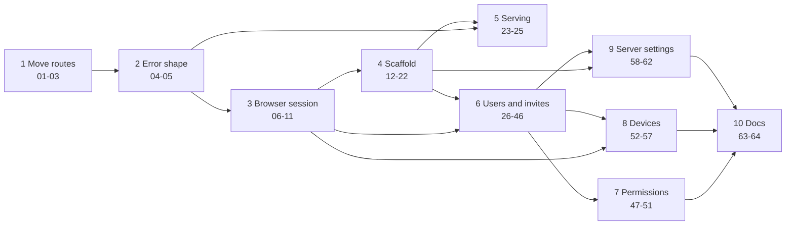

# UI milestone — task list

The admin-foundation milestone from [ui_design.md](../ui_design.md), broken into
64 review-sized tasks. Each task has its own file in this folder (`NN-name.md`)
with its goal, changes, tests and the points worth checking in review.

## How the tasks are shaped

- **One concern per task**, sized to review in one sitting. S is roughly under
  200 changed lines, M under 500.
- **Complete for code review, not necessarily runnable.** A server task comes
  with its pytest tests; a frontend task comes with its Vitest tests against MSW
  mocks. A screen can land before the server route it calls is deployed.
- **Server tasks** go through the repository layer (`app/db/*`), raise `ApiError`
  (task 04), validate with `app/validation.py` (task 26), and test with
  `TestClient` and the `tests/conftest.py` helpers.
- **Frontend tasks** put every string in a translation file, use the generated
  API types (rerun `npm run gen:api` when a route changes), and name multi-word
  query keys in plain English (`['server settings']`).
- **Comments** only where a decision is unusual, never about this planning
  session.
- **Order.** Numbers give a valid order. Within a step, frontend tasks can start
  once their server dependencies have been reviewed.

## Tasks

| Done | # | Task | Step | Depends on | Size |
|------|---|------|------|------------|------|
| [x] | 01 | `/api` router and the `/auth/*` move | 1 Move routes | — | S |
| [x] | 02 | Move `POST /ota/update` to `/api/ota/update` | 1 | 01 | S |
| [x] | 03 | Fix the README authentication section | 1 | 01, 02 | S |
| [x] | 04 | `ApiError`, `field`, `not_found` / `conflict` codes | 2 Error shape | 01 | S |
| [x] | 05 | Validation and 404 handlers | 2 | 04 | S |
| [x] | 06 | Session cookie and CSRF helpers | 3 Browser session | 04 | S |
| [ ] | 07 | Cookie authentication and CSRF in `require_user` | 3 | 06 | M |
| [ ] | 08 | Guard for unauthenticated JSON posts | 3 | 04 | S |
| [ ] | 09 | `POST /api/auth/login` and `/logout` | 3 | 07, 08 | S |
| [ ] | 10 | Password change for cookie sessions; `logout-all` | 3 | 09 | S |
| [ ] | 11 | `GET /api/me` | 3 | 07 | M |
| [ ] | 12 | Vite + React + TS skeleton | 4 Scaffold | — | M |
| [ ] | 13 | Vitest, React Testing Library, MSW | 4 | 12 | S |
| [ ] | 14 | i18n setup | 4 | 13 | M |
| [ ] | 15 | Mantine and app providers | 4 | 14 | S |
| [ ] | 16 | AppShell layout and routes | 4 | 15 | M |
| [ ] | 17 | OpenAPI dump and type generation | 4 | 11, 12 | S |
| [ ] | 18 | API client and query client | 4 | 15, 17 | M |
| [ ] | 19 | Session, route guards, `can()` | 4 | 16, 18 | M |
| [ ] | 20 | Form error helper and login screen | 4 | 19, 09 | S |
| [ ] | 21 | Change password screen | 4 | 20, 10 | S |
| [ ] | 22 | Account screen | 4 | 21 | S |
| [ ] | 23 | Serve the built UI with an SPA fallback | 5 Serving | 05 | M |
| [ ] | 24 | Security headers on UI responses | 5 | 23 | S |
| [ ] | 25 | Multi-stage Dockerfile | 5 | 12, 23 | S |
| [ ] | 26 | Text validation helpers | 6 Users and invites | 04 | S |
| [ ] | 27 | Users read repository | 6 | — | M |
| [ ] | 28 | `GET /api/users` and `/api/users/{id}` | 6 | 27, 05 | S |
| [ ] | 29 | `POST /api/users` | 6 | 26, 28 | S |
| [ ] | 30 | `PATCH /api/users/{id}` | 6 | 29, 10 | S |
| [ ] | 31 | `DELETE /api/users/{id}` | 6 | 30 | S |
| [ ] | 32 | Unlock; log a user out everywhere | 6 | 28, 10 | S |
| [ ] | 33 | Invites repository: issue and revoke | 6 | — | S |
| [ ] | 34 | Issue and revoke invites (admin routes) | 6 | 33, 28 | S |
| [ ] | 35 | `POST /api/invites/check` | 6 | 33, 08 | S |
| [ ] | 36 | Invite redemption transaction | 6 | 35 | M |
| [ ] | 37 | `POST /api/invites/redeem` | 6 | 36, 09 | S |
| [ ] | 38 | `ResponsiveList` component | 6 | 15 | S |
| [ ] | 39 | `Timestamp` and formatting helpers | 6 | 15 | S |
| [ ] | 40 | `ConfirmDanger` and `SecretReveal` | 6 | 15 | M |
| [ ] | 41 | Users query hooks and MSW handlers | 6 | 18, 37 | S |
| [ ] | 42 | Users list screen | 6 | 38, 39, 41, 19 | S |
| [ ] | 43 | User detail: layout and profile | 6 | 42 | S |
| [ ] | 44 | User detail: login and invite | 6 | 43, 40 | M |
| [ ] | 45 | User detail: danger zone | 6 | 43, 40 | S |
| [ ] | 46 | Public invite page | 6 | 41, 20 | M |
| [ ] | 47 | Replace a user's grants (repository) | 7 Permissions | 11 | S |
| [ ] | 48 | `GET /api/permissions` | 7 | 05 | S |
| [ ] | 49 | `GET` / `PUT /api/users/{id}/permissions` | 7 | 47, 48, 28 | M |
| [ ] | 50 | Permissions section: global grants | 7 | 49, 43 | M |
| [ ] | 51 | Permissions section: per-device grants | 7 | 50 | M |
| [ ] | 52 | Devices read repository | 8 Devices | 11 | S |
| [ ] | 53 | `GET /api/devices` and `/api/devices/{id}` | 8 | 52 | S |
| [ ] | 54 | Devices write repository | 8 | 52, 26 | M |
| [ ] | 55 | Device write routes | 8 | 53, 54 | M |
| [ ] | 56 | Devices list and add device | 8 | 55, 38, 39, 40 | M |
| [ ] | 57 | Device detail screen | 8 | 56 | M |
| [ ] | 58 | `server_settings.manage` permission | 9 Server settings | — | S |
| [ ] | 59 | `SettingsStore.describe`, `put`, `reset` | 9 | 58 | M |
| [ ] | 60 | `/api/server-settings` routes | 9 | 59, 05 | S |
| [ ] | 61 | Server settings hooks, fields and labels | 9 | 60, 18 | M |
| [ ] | 62 | Server settings screen | 9 | 61, 40 | M |
| [ ] | 63 | README: web UI and development workflow | 10 Docs | 62 | S |
| [ ] | 64 | Reconcile the design notes | 10 | 63 | S |

Totals: 41 S and 23 M. Step 6 alone is 21 tasks: 12 server, 9 frontend.

## Decisions made while breaking this down

These go beyond ui_design.md, or change it. Each is flagged again in its task.

- **`/ota/update` moves to `/api/ota/update`** (task 02). It is a human action
  behind `ota.manage`. ui_design.md wrongly listed all of `/ota` as box-facing.
- **User routes stop saying "stream token"** (task 04). `AuthError` currently
  uses the stream-specific default messages on user routes.
- **The grant editor gets device ids from `GET /api/permissions`** (task 48),
  because `GET /api/devices` only lists devices the caller can view. As a
  result, `users.manage` reveals every device's id and name.
- **Mantine's `ColorSchemeScript` is left out** (task 15). It is an inline
  script that the planned CSP (task 24) blocks. A light/dark flash on load
  might show; it gets fixed only if it does (see deferred.md).
- **Secret-returning mutations use `gcTime: 0` and are reset on close**
  (task 40). Otherwise TanStack keeps the result in its mutation cache for
  5 minutes.
- **A successful invite redemption counts as a login** (task 37). It writes a
  `success` row to `auth_history` and sets `last_login_at`.
- **Server settings save one row at a time** (task 62), not as a page-wide form.
- **The invite page strips the code from the URL** after reading it (task 46).
- **The OpenAPI dump must not create a stray `firmware-bins/`** (task 17).
  `create_app()` makes that directory as a side effect.
- **A device-detail request from a user without the permission gets 403 even
  for an unknown id** (task 53), so device ids can't be probed.

## Doc issues found

- ui_design.md's table of contents still lists "Open questions", but that section
  is gone. Task 64 fixes it.
- The README `.env` reference still lists old auth variables. Task 03 fixes it.
